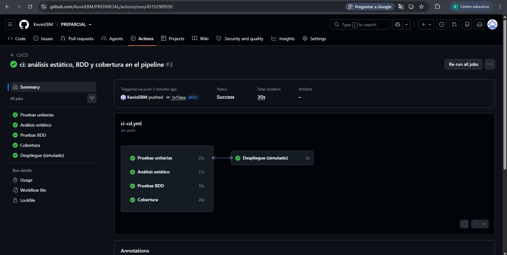
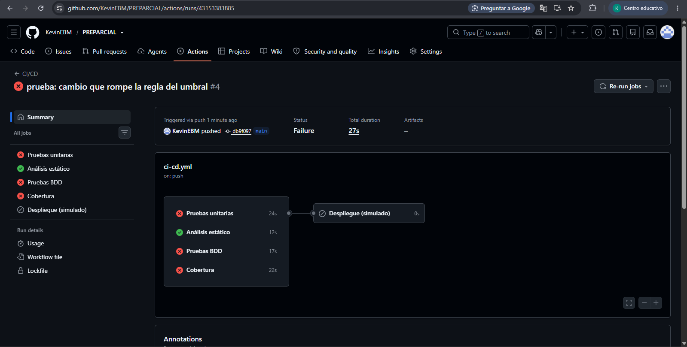
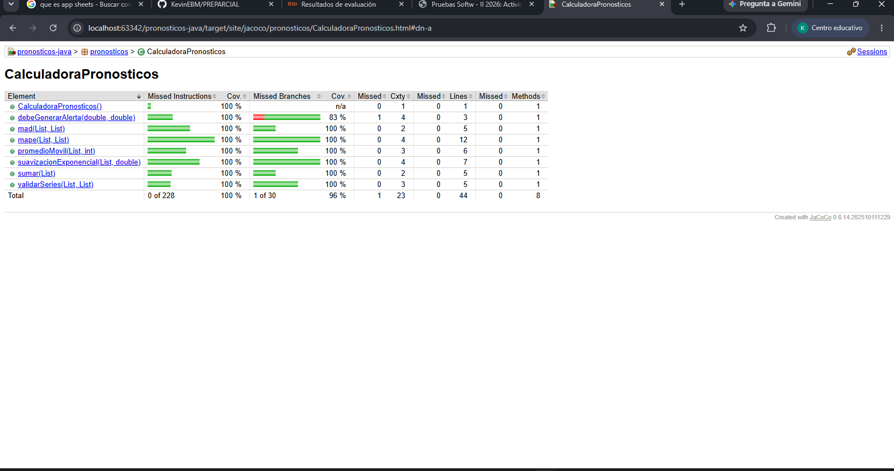
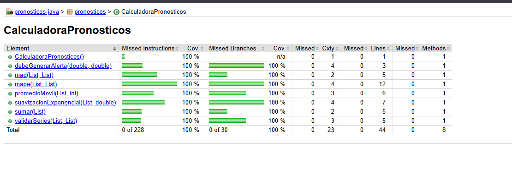

# Informe: Pruebas de la Unidad 2 y pipeline de CI/CD

**Estudiante:** Kevin Esteban Buitrago
**Repositorio:** https://github.com/KevinEBM/PREPARCIAL

## Capturas

### Pipeline en verde

### Pipeline en rojo (Paso 7.5)

### Reporte de cobertura (JaCoCo)

## Preguntas

### 1. ¿Qué vieron en el rojo del Paso 2.1 y por qué en Java suele ser un error de compilación?

Salió COMPILATION ERROR con cannot find symbol sobre suavizacionExponencial.
Java revisa (compila) todo el código antes de correr las pruebas.
Como el método no existía, Java no pudo compilar y la prueba ni siquiera se ejecutó.

### 2. ¿Por qué el MAPE del caso [80, 0, 95] se divide entre 2?

En el periodo 2 la demanda es 0 y no se puede dividir entre 0.
Por eso ese periodo se salta.
Solo quedan 2 periodos válidos (el 1 y el 3), entonces se divide entre 2: (0 + 5,26) / 2 = 2,63.

### 3. ¿Por qué las pruebas unitarias crean la calculadora con new en lugar de levantar Spring?

CalculadoraPronosticos es una clase normal de Java, no usa nada de Spring.
Levantar Spring es más lento y no hace falta para probar un cálculo.
Con new la prueba es rápida y solo prueba la calculadora, sin nada más.

### 4. ¿Qué diferencia hay entre una prueba unitaria y un escenario BDD en este proyecto?

La unitaria está en Java, la escribe un programador y prueba un método con datos (por ejemplo mape).
El escenario BDD está en español (Dado, Cuando, Entonces) y lo puede leer alguien de producción que no programa.
El BDD prueba una regla del negocio (cuándo hay alerta), y aun así se ejecuta como prueba gracias a AlertasSteps.

### 5. En el Paso 7.5, ¿qué pruebas fallaron y por qué el despliegue no corrió?

Cambié >= por > en debeGenerarAlerta.
Fallaron la prueba unitaria de “igual al umbral” en AlertasTest y el escenario BDD “El error es igual al umbral” (y por eso también Cobertura, que corre todas las pruebas).
Con >, un error de 10 con umbral de 10 ya no da alerta, y las pruebas esperaban que sí.
El despliegue no corrió porque tiene needs con los 4 jobs: si uno falla, no se despliega.
Análisis estático sí pasó, porque el código estaba bien escrito; el error era de lógica.